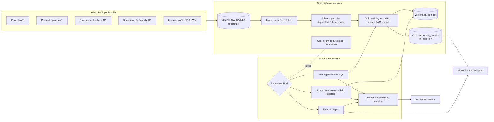

# Procurement Intelligence on Databricks: a governed multi-agent system

A demo-ready **multi-agent AI system** built end to end on **Databricks Free Edition**. It answers procurement questions about World Bank-financed projects in **Kenya** by combining **structured data** (projects, contracts, governance scores), **semi-structured data** (procurement notices) and **unstructured data** (completion reports, IEG evaluations), with every answer verified and every step logged.

> *"How long will a $15M road-works tender take, and what went wrong on similar projects before?"*
> → **P50 311 days / P90 598 days** from a served ML model, plus lessons from completion reports, each citation verified against what the search actually returned.

---

## Architecture

The multi-agent pattern is a **supervisor**: one LLM decides which specialists to call. Each specialist has **one tool and its own guardrails**, so each one can be tested, evaluated and secured separately.

---

## Databricks services demonstrated

| Service | Where | What it does here |
|---|---|---|
| **Workspace** | `procintel/` notebooks 01–10 | All code, versioned in this repo through a Git folder |
| **Unity Catalog** | `01_setup_governance` | Catalog `procintel` with `bronze/silver/gold/ml/ops` schemas, least-privilege grants, tags, PII column tags, models and indexes as governed objects |
| **Lakehouse** | `02`, `07` | Structured, semi-structured and unstructured data in one governed place: tables **and** a Volume of raw files |
| **Delta Lake** | `03`–`05`, `07` | ACID tables, time travel, `DESCRIBE HISTORY`, liquid clustering, `MERGE` upserts, Change Data Feed for incremental index sync |
| **Databricks SQL** | Dashboard *Kenya Procurement Intelligence* | AI/BI dashboard on a serverless SQL warehouse; the Data agent also queries through the warehouse |
| **MLflow** | `06_train_model`, `08_agents` | Experiment tracking, model registry in Unity Catalog with a `champion` alias, agent **tracing**, GenAI **evaluation** |
| **Workflows** | `10_create_job` | Daily DAG defined as code: ingest → bronze → silver → gold → (train ‖ documents) → monitoring, with retries, timeouts, failure emails |
| **Model Serving** | endpoint `procintel-tender-forecast` | The champion model served as a REST API, scale-to-zero; updated automatically when a challenger wins |
| **Evaluation** | `08_agents` Cell 8 | `mlflow.genai.evaluate` with custom code scorers and built-in LLM judges, adversarial cases included |
| **Audit Logs** | `09_monitoring` | `system.access.audit` (who accessed which object) and `system.access.table_lineage` (bronze → gold lineage) |
| **Application / System Logs** | `09_monitoring`, `ops.agent_requests` | Append-only agent request log linked to MLflow traces; `system.query.history` for SQL activity; the App's deployment history and logs |
| **Databricks Apps** (prototype UI) | `app/` | Streamlit chat UI running as its own service principal with declared resources and least-privilege grants |

---

## Data

All data is public World Bank open data, filtered to Kenya (CC BY 4.0).

| Source | API | Raw records |
|---|---|---|
| Projects | `search.worldbank.org/api/v2/projects` | 282 |
| Contract awards (STEP) | `search.worldbank.org/api/contractdata` | 6,661 |
| Procurement notices | `search.worldbank.org/api/v2/procnotices` | 7,251 |
| Documents (metadata + text) | `search.worldbank.org/api/v2/wds` | 8,758 (734 reports downloaded as text) |
| Governance indicators | `api.worldbank.org/v2` (CPIA, WGI 2025 revision) | 147 |

**23,099 raw records**, each landing count verified against the API's own total.

---

## Results

| What | Result |
|---|---|
| Derived training labels (notice → contract linked through the STEP activity number) | 870 linked, **716 valid** after quality rules |
| Median tender duration (valid labels) | **200 days** (155 before removing invalid negative durations) |
| Tender-duration model, mean absolute error | **76 days** vs **118 days** for a per-method baseline (−36%) |
| Cost of a training/serving skew found and fixed | old champion **94.8 days** vs fixed model **75.9 days** on the same test set; the gate promoted the fix automatically |
| P90 "safe-to-commit" coverage | **87%** (target 90%) |
| Supplier names merged by normalisation | 4,159 → 3,994 |
| Report chunks embedded in Vector Search | 3,132 focused passages (from 76,047 chunks) |
| Agent evaluation (9 questions incl. adversarial, run on the deployed `agent_core`) | routing 1.00 · strict out-of-scope refusal 1.00 · safety 1.00 · relevance 0.89 · verifier 0.89 (one answer flagged, see limitations) |
| Daily Workflow | 7-task DAG, green end to end |

---

## Notebooks

| # | Notebook | Purpose |
|---|---|---|
| 00 | `00_api_exploration` | The API detective work: egress test, filter verification, endpoint discovery (kept as a lab notebook) |
| 01 | `01_setup_governance` | Catalog, schemas, volume, grants, tags, app service-principal grants |
| 02 | `02_ingest_bronze` | API exploration, then paginated download of raw JSONL into the Volume |
| 03 | `03_bronze_tables` | `read_files` → Bronze Delta tables with lineage columns |
| 04 | `04_silver` | Typing, de-duplication (`QUALIFY ROW_NUMBER`), supplier explode and normalisation, PII minimisation |
| 05 | `05_gold` | Leakage-safe training set, KPI tables, RAG document selection |
| 06 | `06_train_model` | Temporal split, P50/P90 gradient boosting, MLflow logging, champion/challenger gate |
| 07 | `07_documents` | Text download, structure-aware chunking, focused corpus, Vector Search index |
| 08 | `08_agents` | Data, Documents and Forecast agents, supervisor, verifier, logging, evaluation |
| 09 | `09_monitoring` | Audit, lineage, query-history and app-log views |
| 10 | `10_create_job` | Workflow defined as code |
| 11 | `11_demo` | Demo notebook: question box → answer, agents used, verification, sources, trace |
| app | `app/agent_core.py` | **The single agent module** (agents, supervisor, verifier, logging), shared by `11_demo` and the App |
| app | `app/app.py`, `app.yaml`, `requirements.txt` | Databricks App: Streamlit chat UI |

---

## How to run it

1. Sign up for **Databricks Free Edition** (free, no card).
2. Workspace → your home folder → **Create → Git folder** → paste this repo's URL → name it `procintel`.
3. Run notebooks **01 → 07** in order once. `07_documents` starts the Vector Search index build in the background (about 1 hour on Free Edition).
4. Run `08_agents` to develop and evaluate the agents, and `11_demo` to try them.
5. Run `10_create_job` to create the daily pipeline.
6. **App:** Compute → Apps → Create custom app → add resources (SQL warehouse with key `sql-warehouse`, the LLM and `procintel-tender-forecast` endpoints, the search index) → run the service-principal GRANTs in `01_setup_governance` → Deploy from `procintel/app`.

---

## Design decisions and lessons learned

- **Inspect before you build.** Every API was sampled first. Comparing filtered and unfiltered totals exposed two filters the APIs **silently ignored** (one returned Ecuador for a Kenya filter).
- **Discover, don't guess.** The WGI indicator codes had changed (2025 revision) and the "obvious" contract dataset was a filtered view. Both were caught by probing.
- **Pagination by records received, not requested,** so a server that caps page size can't make the pipeline silently skip data.
- **Weak supervision with quality rules.** The public data has no tender-duration column; it's derived by linking notices to contracts through the STEP activity number hidden in reference codes. Invalid links are counted, not hidden.
- **No target leakage.** Only planning-time features; governance scores joined as-of the previous year; re-advertisement counts excluded.
- **Curated retrieval.** Free Edition embeds about 60 chunks/minute, so the index holds the ~3k highest-value passages (lessons and procurement sections). Indexing the full corpus is a capacity change, not a code change.
- **Defence in depth for SQL.** Prompt rules, a code-level SQL check (SELECT only, Gold only), and Unity Catalog permissions.
- **A verifier that fails closed.** The first version passed an answer whose citations it could not parse. It now requires every number to match a tool result and every citation to be one that was actually retrieved.
- **Logs catch what evaluation misses.** Production logs exposed an out-of-scope question being routed to the forecast model, which a too-lenient scorer had passed. The scorer was tightened and the prompt fixed.
- **Training/serving skew, found in a trace.** Sector arrays were stringified differently in training (pandas) and serving (SQL API), so the live model silently ignored sector. Normalising the feature once in Silver fixed it; the champion/challenger gate measured the cost (94.8 → 75.9 days MAE) and promoted the fix.
- **One source of truth for agent code.** `app/agent_core.py` has no Spark dependency, so the same module runs in notebooks and in the App, and the evaluation tests the exact code that is deployed.
- **Exploration vs production notebooks.** The first scheduled run failed on a probe cell that was *meant* to error. Exploration moved to `00_api_exploration`; production notebooks must pass "clear state and run all".

---

## Limitations and next steps

- Evaluation set of 9 questions: grow it to ~50 with hand-labelled reference answers.
- One evaluation answer is still flagged by the verifier (a number not traceable to a tool result); next step is to inspect it and tighten the prompt or the forecast output format.
- Rule-based supplier normalisation: add fuzzy matching and a prefix list (e.g., "M/S").
- P90 slightly optimistic (87%): add conformal calibration.
- Log the supervisor as an MLflow model and serve it as its own endpoint (the App currently calls the agents directly).
- Weight retrieval by recency so 1990s reports don't outrank recent ones.
- Migrate MLflow traces to Unity Catalog storage; switch to the renamed `databricks-ai-search` package.

---

*Built as a learning project. Data © World Bank, licensed CC BY 4.0.*
